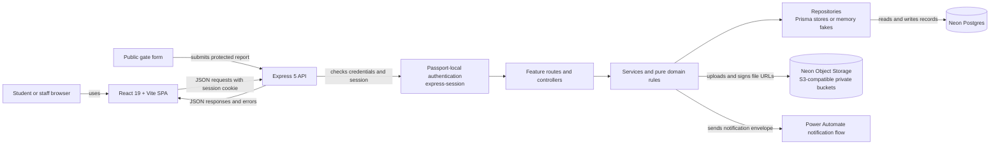

<h1 align="center">
  
  &nbsp;Student Discipline Office Management System
</h1>

<h4 align="center">Track disciplinary cases from report to clearance.</h4>

<p align="center">
  A <b>database-backed discipline workflow</b> for <i>students, staff, and public gate reporting</i>. It combines a React SPA with an <code>Express</code> API, Prisma repositories, and protected file storage. Students and staff can follow cases, sanctions, appointments, clearance requirements, and notifications in one system.
</p>
<p align="center"><sub>Apache-2.0 licensed · TypeScript monorepo</sub></p>

<p align="center">
  
  
  
  
  
  
</p>

<p align="center">
  
</p>
<p align="center"><sub><i>Preview asset from the client application.</i></sub></p>

### What problem does it solve?

Disciplinary records, sanctions, appointments, proof files, and clearance requirements need to move through a shared workflow instead of separate manual handoffs. Students need visibility into their own cases, while staff need tools to validate submissions, assign sanctions, schedule appointments, and manage notices. This system centralizes those operations behind role-aware API routes and a React client backed by Postgres repositories.

### Features

- **Case workflow**<br>Records, validates, rejects, resolves, and annotates disciplinary cases.
- **Sanctions and proof**<br>Assigns sanctions and accepts student proof files for staff verification.
- **Student handbook**<br>Lists handbook entries and supports staff maintenance of violations and sanctions.
- **Appointments**<br>Creates, updates, completes, and cancels case-related appointments.
- **Clearance tracking**<br>Sets up terms and tracks student clearance requirements through completion.
- **Notifications**<br>Maintains student and shared staff inboxes and sends notification payloads to Power Automate.
- **Public gate reports**<br>Accepts protected unauthenticated gate reports with a form token and rate limits.
- **Role-aware access**<br>Uses Passport-local authentication, sessions, staff guards, and student guards across API routes.

### Usage

Run the API and Vite client together, then open the client origin printed by Vite.

#### Run the main workflow

```bash
npm run dev
```

The API exposes a dependency-free health probe at `GET /health`:

```bash
curl http://localhost:3000/health
```

```json
{"status":"ok"}
```

### Environment and configuration

Copy the safe example configuration before running the configured application:

```bash
cp .env.example .env
```

#### Variables

| Variable | Required | Description | Example |
|---|---:|---|---|
| `CLIENT_PORT` | No | Vite development and preview port | `5173` |
| `SERVER_PORT` | No | Express API port; falls back to `PORT`, then `3000` | `3000` |
| `DATABASE_URL` | For database mode | Pooled Neon Postgres URL for runtime access | `postgresql://example_user:...` |
| `DATABASE_URL_UNPOOLED` | For Prisma CLI | Direct Neon Postgres URL for Prisma commands | `postgresql://example_user:...` |
| `SESSION_SECRET` | For authentication | Server-side session signing secret | `example-session-secret-change-me-32-chars-min` |
| `APP_BASE_URL` | Deployment | Client origin and base URL for email links | `http://localhost:5173` |
| `VITE_API_URL` | Deployment only | API host exposed to the browser when it is separate | `https://api.example.edu` |
| `PA_NOTIFY_URL` | Optional | Power Automate notification trigger URL | `https://example.invalid/powerautomate/notify` |
| `PA_JOB_KEY` | Optional | Key for the internal term-setup job header | `example-job-secret-change-me-32-chars-min` |
| `TRUST_PROXY` | Optional | Reverse-proxy count used for client IP handling | `1` |
| `AWS_ACCESS_KEY_ID` | Storage mode | S3-compatible storage access key | `EXAMPLEACCESSKEYID` |
| `AWS_SECRET_ACCESS_KEY` | Storage mode | S3-compatible storage secret | `example-secret-access-key` |
| `AWS_ENDPOINT_URL_S3` | Storage mode | S3-compatible storage endpoint | `https://example.invalid` |
| `AWS_REGION` | Storage mode | S3-compatible storage region | `us-east-2` |
| `STORAGE_BUCKET_FILES` | Storage mode | Private bucket for student proof files | `assets-files` |
| `STORAGE_BUCKET_TEMPLATES` | Storage mode | Private bucket for sanction templates | `assets-sanction-templates` |

#### Configuration files

The repository-root `.env` is read by both packages. Vite exposes only `VITE_` variables to browser code; do not put secrets in them. The API reads server settings through `api/src/config/`.

### API reference

The Express API uses session cookies for authenticated browser requests. Routes are registered in `api/src/routes/index.ts`; all routes return the shared API response shapes except the plain `/health` probe.

#### `GET /health`

Returns a database-independent liveness response.

```json
{"status":"ok"}
```

#### `POST /auth/login` and `POST /auth/logout`

Starts or ends a Passport-local session. `GET /auth/me` returns the current authenticated account.

#### `GET /me/cases` and `GET /me/sanctions`

Returns the signed-in student's cases and sanctions.

#### `GET /cases` and `POST /cases`

Lists staff case records and records a case through the staff workflow.

#### `GET /public/gate-form-options` and `POST /public/gate-reports`

Provides public gate-form options and accepts a report protected by a form token and rate limits.

#### Errors

| Status | Meaning |
|---:|---|
| `400` | Invalid request data |
| `401` | Authentication required |
| `403` | Authenticated account lacks the required role |
| `404` | Route or record not found |
| `503` | Server configuration is unavailable |

### Architecture



<sub>Agent-created from the Express app, feature route registry, service layers, Prisma repositories, storage configuration, and notification integration.</sub>

### Project structure

```text
api/                         Express API, services, repositories, and tests
├── prisma/                  Prisma schema and migration files
├── scripts/                 API maintenance and smoke scripts
├── src/                     Routes, controllers, domain, config, and stores
└── tests/                   API and view tests
client/                      React SPA and client-side tests
├── public/                  Browser icons and static assets
├── src/                     Routes, pages, components, hooks, and API client
└── tests/                   Client component, page, route, and utility tests
docs/                        Project handoff and architecture documentation
├── diagrams/                Repository architecture diagrams
└── sdao-handoff/            Product specification and implementation rules
shared/                      Types shared by the API and client
.env.example                 Safe local configuration template
package.json                 Root scripts for development and verification
LICENSE                      Apache-2.0 license text
```

### Getting started

#### Prerequisites

- Node.js and npm
- A cloned checkout of the repository
- A root `.env` for configured database, session, storage, or notification features

#### Clone and run

```bash
git clone https://github.com/Aicyraa/SDO.git
cd SDO
npm install
npm --prefix api install
npm --prefix client install
npm run dev
```

#### Run the tests

```bash
npm test
```

For a complete local verification pass:

```bash
npm run lint
npm run typecheck
npm run build
```

### Contributors

<a href="https://github.com/Aicyraa/SDO/graphs/contributors">
  
</a>

### License

Distributed under the Apache-2.0 License. See [`LICENSE`](LICENSE) for details.
